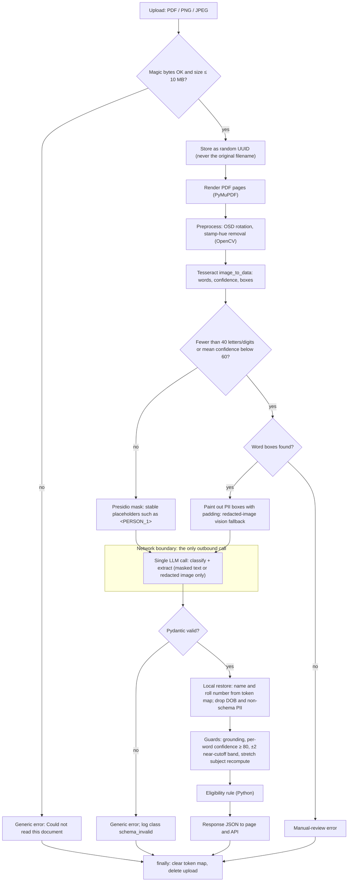
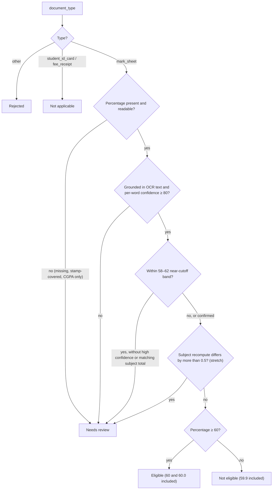
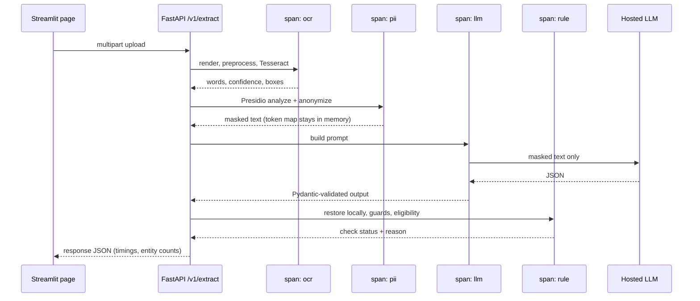

# OCR_DOC_Checker — Architecture

## 1. Purpose

LearnSphere College's admissions office in Pune processes about 2,000 scans each season. Officers currently read board mark sheets by hand to decide whether a student clears the **60% cutoff**. Stamps often cover the totals, and two officers can read the same sheet differently. OCR_DOC_Checker accepts a PDF or image and does four things:

1. Classifies the document as a mark sheet, student ID card, fee receipt or `other`.
2. Extracts five fields.
3. Runs the cutoff check in Python, on mark sheets only.
4. Returns one JSON object, the same one to the web page and to `POST /v1/extract`.

OCR and PII masking run locally. The only network call is a single LLM request, and it sees masked text only. Any doubtful number returns **Needs review** rather than a guessed result. All documents are synthetic.

## 2. Tech stack

| Layer | Tool | Why |
|---|---|---|
| OCR engine | **Tesseract 5** (UB Mannheim build, local) + `pytesseract` | Runs locally. `image_to_data` gives per-word confidence and bounding boxes. OSD detects rotation. |
| PDF → image | `pymupdf` | Renders PDF pages without needing Poppler on Windows |
| Preprocessing | `opencv-python-headless`, `numpy`, `pillow` | Rotation fix, stamp-hue removal, binarization, crops |
| PII masking | `presidio-analyzer`, `presidio-anonymizer` | Local detection and anonymization; custom recognizers for Indian IDs |
| NER model | spaCy `en_core_web_lg` | Finds names more reliably than the small model |
| LLM | **OpenRouter** (OpenAI-compatible `/chat/completions`) via `httpx`; model chosen by `LLM_MODEL`, vision-capable for the fallback | One classify-and-extract call on masked text; one key gives access to many models |
| Validation | `pydantic`, `pydantic-settings` | Strict output schema; settings read from env |
| API | `fastapi`, `uvicorn[standard]`, `python-multipart` | `POST /v1/extract` with multipart upload |
| UI | `streamlit` (**tentative**, pending confirmation) | The page calls the API, so both return the same object |
| Telemetry | `opentelemetry-api`, `-sdk`, `-instrumentation-fastapi` | Spans `ocr`, `pii`, `llm`, `rule`; console exporter. JSON-lines fallback. |
| Synthetic data | `faker` (en_IN), Pillow, PyMuPDF | Generated documents only, never real scans |
| Tests and eval | `pytest`, `eval/evaluate.py` | Rule boundaries, telemetry leak test, three accuracy metrics |

## 3. Request pipeline



## 4. Eligibility decision



CGPA is never converted to a percentage.

## 5. Request sequence and telemetry



## 6. Response contract

```json
{
  "request_id": "7c1e0a4e-3d2b-4f0a-9c11-2a9b0e6d4f18",
  "document_type": "mark_sheet",
  "fields": {
    "student_name": "Aisha Rahman",
    "roll_number": "CBSE24-104482",
    "board_or_school": "CBSE",
    "passing_year": 2024,
    "percentage": 76.4
  },
  "check": { "status": "Eligible", "reason": "Percentage is at least 60." },
  "pii": { "masked_before_llm": true, "entity_counts": { "PERSON": 1, "IN_PHONE": 1 } },
  "pipeline": {
    "ocr_engine": "tesseract",
    "used_vision_fallback": false,
    "timings_ms": { "ocr": 640, "pii": 38, "llm": 1102, "rule": 3 }
  }
}
```

`document_type` is one of `mark_sheet`, `student_id_card`, `fee_receipt` or `other`. All five fields are optional; `percentage` is 0–100 and `passing_year` is a four-digit year. `check.reason` never contains names, IDs or numbers that identify a student.

## 7. Telemetry

| Record | Never record |
|---|---|
| request_id, document type, page count, file extension | OCR text, prompt, model completion |
| OCR engine, character count, mean confidence, fallback flag | Field values: names, roll numbers |
| Entity counts by type, placeholder counts | The placeholder token map |
| Model name, token counts, prompt version, stage durations | The original filename |
| Check status, error class (`ocr_empty`, `schema_invalid`, …) | Names or roll numbers as metric labels |

- **Metrics counters:** requests by outcome, stage latency, fallback rate, entities by type, and check results by status.
- **Allowlist enforcement:** spans and log lines go through one helper that accepts only keys from a fixed allowlist and rejects anything else. Exceptions are recorded with `record_exception=False`, so error messages can't leak text.
- **Leak test:** `pytest` runs every sample, captures the exported spans and logs, and fails if any synthetic name or roll number appears in them.
- **UI panel:** shows the last request's four stages, their durations, the status and the entity counts.

## 8. Security rules

- Synthetic documents only. No real mark sheets, IDs or receipts in the repo, the demo or the test set.
- OCR and Presidio run locally. The LLM call happens only after masking, on a plan that doesn't train on prompts. Every OpenRouter request sets `provider.data_collection = "deny"`, so it is only routed to providers that don't store or train on prompts.
- Custom recognizers cover Aadhaar, PAN, Indian mobile numbers, bank accounts, policy numbers, roll numbers, date of birth, email, parent names and addresses.
- Placeholders are stable within a request. Values are normalized for case and whitespace first, so `RAVI MENON` and `Ravi Menon` get the same token. The map is kept in memory only and cleared in `finally`.
- The vision fallback sends only a redacted image. If OCR found no boxes, the hosted model is never called.
- Uploads are checked by magic bytes, capped at 10 MB, stored under a UUID and deleted when the request ends.
- Clients see only `Could not read this document`. Logs record only an error class.
- The API key is read from env. `.env.example` is committed empty and `.env` is git-ignored.
- CORS is limited to our own page, HTTPS is used if deployed, and request-body capture is off in any error tracker.

## 9. Repo layout

```
OCR_DOC_Checker/
├─ app/
│  ├─ main.py            FastAPI app, POST /v1/extract, CORS, OTel instrumentation
│  ├─ config.py          env settings
│  ├─ schemas.py         LearnSphereFields, LLMOutput, ExtractResponse
│  ├─ pipeline.py        stage orchestration; finally: clear token map, delete upload
│  ├─ upload.py          magic bytes, 10 MB cap, UUID storage
│  ├─ errors.py          error classes → generic client message
│  ├─ telemetry.py       tracer, meter, attribute allowlist, JSONL fallback
│  ├─ ocr/               render.py, preprocess.py, tesseract.py
│  ├─ pii/               recognizers.py, masker.py, redact_image.py
│  ├─ llm/               prompt.py, client.py
│  └─ rules/             eligibility.py, guards.py, subjects.py
├─ ui/streamlit_app.py   upload, JSON, status, masked text, telemetry panel, review crop
├─ data/
│  ├─ generate.py        synthetic document generator
│  ├─ samples/dev/       tuning set
│  ├─ samples/test/      20 held-back documents
│  └─ test_set.csv       filename, true type, true fields, expected status
├─ eval/evaluate.py      field match, doc-type accuracy, rule accuracy
├─ tests/                rule boundaries, magic bytes, token stability, telemetry leak
├─ docs/ARCHITECTURE.md
├─ .env.example  .gitignore  requirements.txt  README.md
```

## 10. Build phases

| # | Phase | Done when |
|---|---|---|
| 0 | Setup: venv, Tesseract, spaCy model, git | Tesseract callable from Python |
| 1 | Synthetic data + `test_set.csv` | About 40 documents render; CSV complete |
| 2 | Upload + OCR + rotation + stamp preprocessing | Command-line tool prints OCR stats; rotated samples are corrected |
| 3 | Presidio masking + telemetry skeleton | Token tests and leak test pass |
| 4 | LLM call + Pydantic | Valid JSON for all four types |
| 5 | Restore + rule + guards | Boundary tests pass; a stamped total gives Needs review |
| 6 | FastAPI + Streamlit + telemetry panel | All four demo steps work end to end |
| 7 | Eval script | Three accuracy numbers reported on the test set |
| 8 | Vision fallback | Near-empty OCR takes the redacted path |
| 9 | README | Run steps, the two-totals choice, where the key is read, deviations |
| 10 | Stretch: subject recompute | A difference over 0.5 gives Needs review showing both figures |
